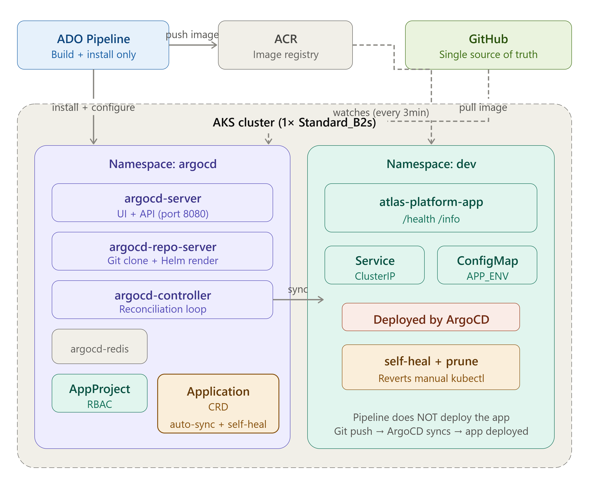
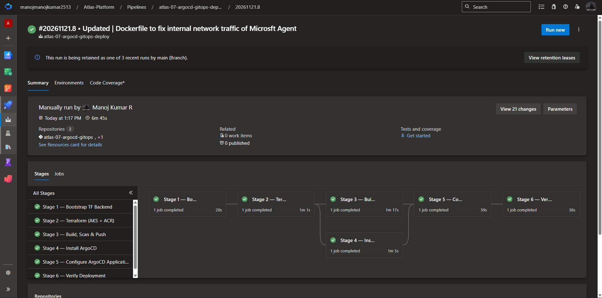
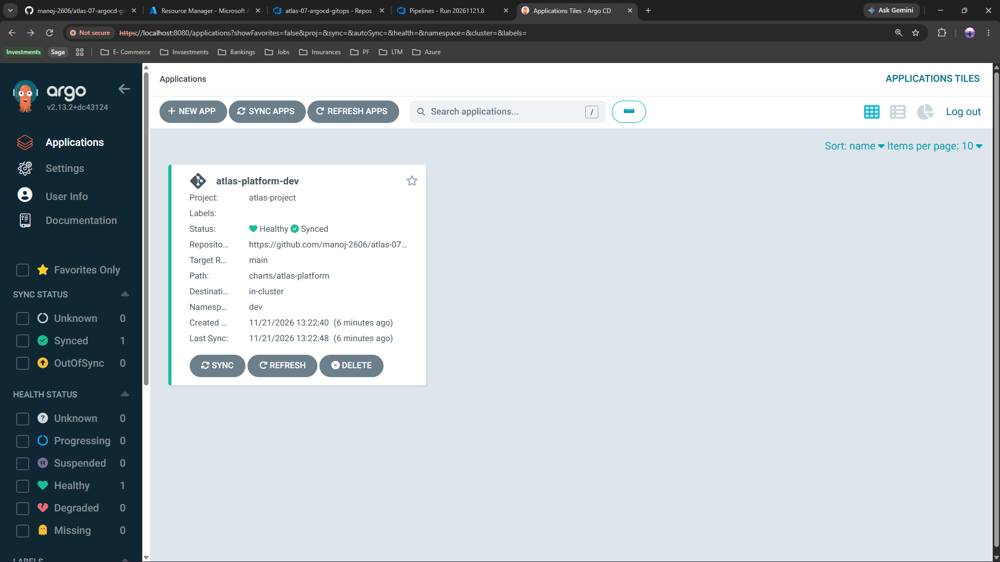
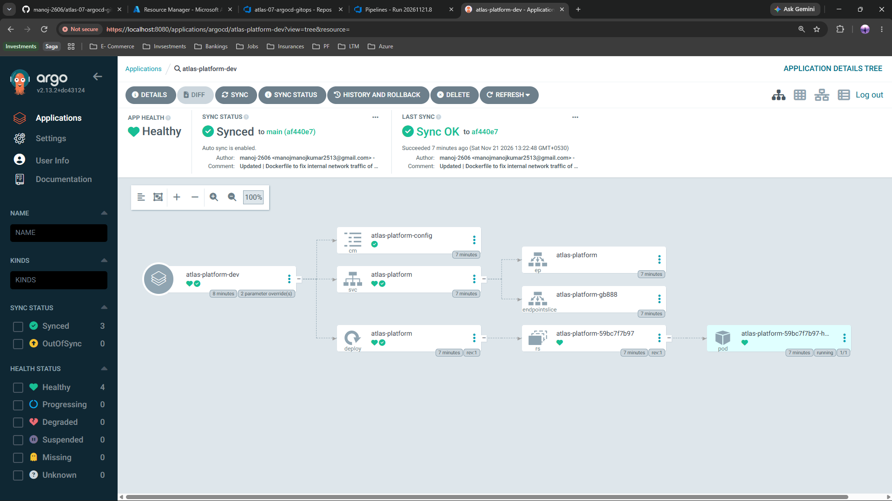
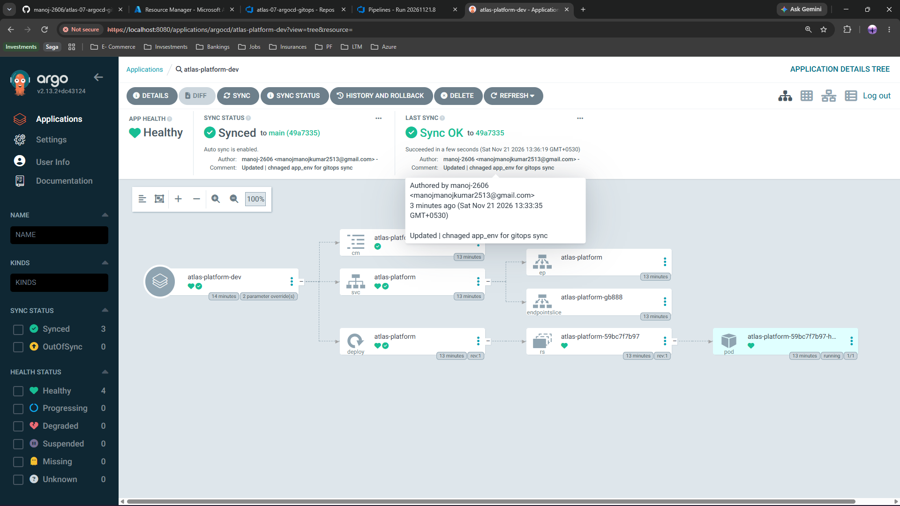
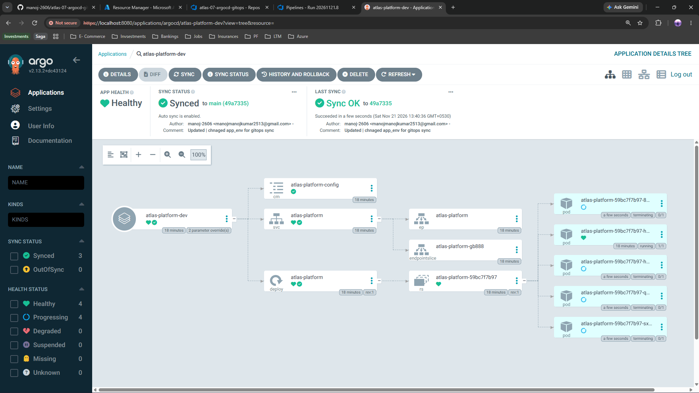
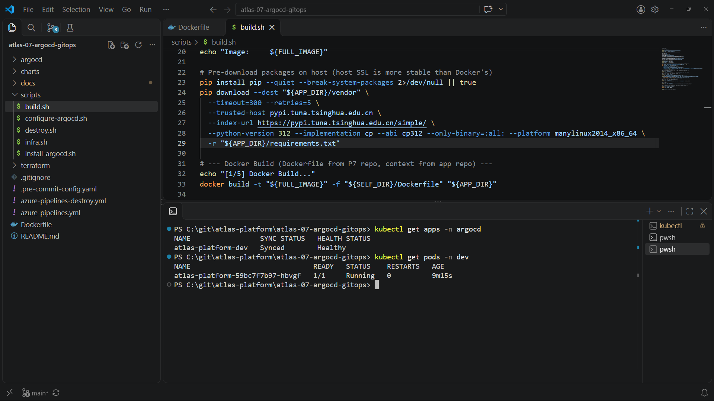

# Atlas-07: GitOps with ArgoCD — Pull-Based Deployment on AKS

> **Project 7 of 11** in the [Atlas Platform Portfolio](https://github.com/manoj-2606) — a production-grade Azure cloud engineering portfolio targeting Senior DevOps/Platform Engineer roles in Europe.

## Problem

Projects P1–P6 use **push-based deployment**: the pipeline runs `helm upgrade` to push changes into the cluster. This is the most common pattern — and it has real problems at scale:

- **Drift is invisible.** Someone runs `kubectl edit` in production, the cluster silently diverges from Git, and no one knows until the next deploy overwrites their change — or doesn't.
- **Rollback means re-running pipelines.** There's no single source of truth to revert to. "What's deployed right now?" requires `kubectl get` commands, not `git log`.
- **Pipeline = deploy permission.** Anyone who can trigger the pipeline can deploy anything. There's no separation between "build the artifact" and "put it in production."
- **No self-healing.** If a pod config is manually changed or deleted, it stays broken until the next pipeline run.

These aren't theoretical problems — they're the reason GitOps exists.

## Solution

This project replaces push-based deployment with **GitOps using ArgoCD**:

- **ArgoCD watches Git** — detects changes to Helm charts, syncs them to the cluster automatically
- **Git is the single source of truth** — `git log` shows exactly what's deployed and when
- **Self-healing enabled** — manual `kubectl` changes are reverted within seconds
- **Pipeline stops at "build"** — it provisions infrastructure, builds the image, installs ArgoCD, and configures Applications. It does NOT deploy the app. ArgoCD takes over.
- **Separation of concerns** — pipeline owns the artifact, ArgoCD owns the deployment

The paradigm shift: **the pipeline no longer deploys. Git does.**

## Architecture

### Push vs Pull — The Paradigm Shift

```
PUSH-BASED (P1–P6):
  Developer → Git Push → Pipeline → helm upgrade → Kubernetes
  (Pipeline has cluster credentials and deploys directly)

PULL-BASED (P7 — GitOps):
  Developer → Git Push → Git Repo ← ArgoCD (watches) → Kubernetes
  (Pipeline builds the image. ArgoCD watches Git and deploys.)

  Pipeline: build image → push to ACR → install ArgoCD → configure Application CRD
  ArgoCD:   watch Git repo → detect drift → sync Helm chart → self-heal
```


### GitOps Data Flow

```
┌──────────────────────────────────────────────────────────────────────┐
│                                                                      │
│  ADO Pipeline (azure-pipelines.yml)                                  │
│       │                                                              │
│       ├── Stage 1: Bootstrap (tfstate storage)                       │
│       ├── Stage 2: Infrastructure (Terraform → AKS + ACR)           │
│       ├── Stage 3: Build (Docker → Trivy → ACR push)  ─┐            │
│       ├── Stage 3: InstallArgoCD (Helm install)      ───┤ PARALLEL   │
│       ├── Stage 5: ConfigureArgoCD                      │            │
│       │       ├── Apply AppProject (RBAC boundary)                   │
│       │       └── Apply Application CRD (what to watch)              │
│       └── Stage 6: Verify (sync status + smoke test)                 │
│                                                                      │
│  After pipeline completes:                                           │
│                                                                      │
│  GitHub Repo (charts/atlas-platform/)                                │
│       │                                                              │
│       ▼  ArgoCD watches (every 3 minutes or webhook)                 │
│  ┌─────────────┐                                                     │
│  │   ArgoCD    │──── Detects drift ──→ Syncs Helm chart to AKS      │
│  │  (pull)     │──── Self-heals   ──→ Reverts manual kubectl edits  │
│  │             │──── Prunes       ──→ Deletes orphaned resources    │
│  └─────────────┘                                                     │
│       │                                                              │
│       ▼                                                              │
│  dev namespace: atlas-platform-app (Deployment + Service + ConfigMap)│
│                                                                      │
└──────────────────────────────────────────────────────────────────────┘
```

### ArgoCD Component Map

```
argocd namespace:
  ├── argocd-server          → UI + API (port-forward 8080)
  ├── argocd-repo-server     → Clones Git repos, renders Helm charts
  ├── argocd-application-controller → Watches Application CRDs, performs sync
  ├── argocd-redis            → Cache for controller
  ├── AppProject: atlas-project      → RBAC: which repos/namespaces allowed
  └── Application: atlas-platform-dev → What to watch, where to deploy, sync policy

dev namespace:
  ├── Deployment: atlas-platform-app
  ├── Service: atlas-platform-app
  └── ConfigMap: atlas-platform-config
```

### Infrastructure

| Component | Sizing | Why |
|-----------|--------|-----|
| AKS | 1× Standard_B2s (4GB) | ArgoCD is lightweight (~832MB total) — single node sufficient |
| ArgoCD Server | 256Mi limit | UI + API |
| ArgoCD Repo Server | 256Mi limit | Git clone + Helm render |
| ArgoCD Controller | 512Mi limit | Reconciliation loop — heaviest component |
| ArgoCD Redis | 128Mi limit | In-memory cache |
| atlas-platform-app | 256Mi limit | The workload being deployed via GitOps |
| ACR | Basic SKU | Image storage |

## Repo Structure

```
atlas-07-ArgoCD-GitOps/
├── terraform/
│   ├── main.tf                          # atlas-infra-base module (1× B2s)
│   ├── variables.tf
│   ├── outputs.tf
│   └── environments/
│       └── dev.tfvars                   # 1 node, K8s 1.36.5, cost tags
│
├── Dockerfile                           # Multi-stage, non-root, path-traced
│
├── charts/
│   └── atlas-platform/                  # App Helm chart (ArgoCD watches this path)
│       ├── Chart.yaml
│       ├── values.yaml                  # ★ Image tag set here, ArgoCD syncs changes
│       └── templates/
│           ├── _helpers.tpl
│           ├── deployment.yaml
│           ├── service.yaml
│           └── configmap.yaml
│
├── argocd/
│   ├── install/
│   │   └── values-argocd.yaml           # ★ ArgoCD Helm overrides (B2s-safe)
│   ├── appprojects/
│   │   └── atlas-project.yaml           # ★ RBAC boundary (allowed repos/namespaces)
│   └── applications/
│       └── atlas-platform-dev.yaml      # ★ Application CRD (what to watch + sync policy)
│
├── scripts/
│   ├── infra.sh                         # Terraform init/plan/apply + output vars
│   ├── build.sh                         # Docker build + Trivy + ACR push
│   ├── install-argocd.sh                # Helm install ArgoCD with pinned version
│   ├── configure-argocd.sh              # Apply AppProject + Application CRD
│   └── destroy.sh                       # Terraform destroy + verify
│
├── azure-pipelines.yml                  # Deploy (6 stages, external .sh scripts)
├── azure-pipelines-destroy.yml          # Destroy (approval gate)
│
├── docs/
│   ├── pipeline-stages.png              # Screenshot: 6 stages passed
│   ├── argocd-app-synced.png            # Screenshot: Application synced + healthy
│   ├── argocd-resources.png             # Screenshot: Resource tree in ArgoCD UI
│   ├── gitops-sync-demo.png             # Screenshot: After values.yaml change
│   ├── self-heal-demo.png               # Screenshot: ArgoCD reverts manual edit
│   └── app-health-check.png             # Screenshot: /health endpoint working
│
├── .pre-commit-config.yaml
├── .gitignore
└── README.md
```

## How to Run

### Prerequisites
- Azure subscription with Contributor access
- Azure DevOps project `Atlas-Platform` with `MI-ADO-API` service connection
- Terraform state backend: `atlastfstate2606` in `rg-atlas-tfstate`
- `atlas-platform-app` repo in ADO (multi-repo checkout)

### Deploy

```bash
# 1. Push code to ADO
git remote add ado https://dev.azure.com/manojmanojkumar2513/Atlas-Platform/_git/atlas-07-ArgoCD-GitOps
git push ado main

# 2. Set ADO repo permissions (Build Service → Contribute + Bypass)

# 3. Create environments: atlas-07-deploy (no approval), atlas-07-destroy (approval)

# 4. Create pipeline → azure-pipelines.yml → Run
#    Stage 1: Bootstrap (tfstate storage)
#    Stage 2: Infrastructure (Terraform → AKS 1 node + ACR)
#    Stage 3: Build (Docker → Trivy → SBOM → ACR push)       ─┐
#    Stage 3: InstallArgoCD (Helm install ArgoCD 7.7.10)      ─┤ PARALLEL
#    Stage 5: ConfigureArgoCD (AppProject + Application CRD)
#    Stage 6: Verify (sync status check + smoke test)
```

### Manual Verification (after pipeline completes)

```bash
# Get AKS credentials
az aks get-credentials --resource-group rg-atlas-07-dev --name aks-atlas-07-dev

# Access ArgoCD UI
kubectl port-forward svc/argo-cd-argocd-server 8080:443 -n argocd
# Open https://localhost:8080
# Username: admin
# Password: kubectl -n argocd get secret argocd-initial-admin-secret -o jsonpath="{.data.password}" | base64 -d

# Check Application status
kubectl get applications -n argocd
# Should show: atlas-platform-dev  Synced  Healthy

# Demo: GitOps Sync (change image tag in values.yaml, push to GitHub)
# Edit charts/atlas-platform/values.yaml → change image.tag
# git add . && git commit -m "bump image tag" && git push origin main
# Watch ArgoCD UI — it auto-syncs within 3 minutes

# Demo: Self-Heal (manually edit deployment, watch ArgoCD revert it)
kubectl scale deployment atlas-platform-app -n dev --replicas=5
# Watch ArgoCD UI — it reverts to 1 replica within seconds

# Verify app is running
kubectl exec -n dev $(kubectl get pod -n dev -l app.kubernetes.io/name=atlas-platform --field-selector=status.phase=Running -o jsonpath='{.items[0].metadata.name}') -c atlas-platform -- python -c "
import urllib.request, json
r = urllib.request.urlopen('http://localhost:8000/health')
print(json.loads(r.read()))"
```

### Destroy

```bash
# Create pipeline → azure-pipelines-destroy.yml → Run
# Requires approval on atlas-07-destroy environment
# Verify: Azure Portal → Resource Groups → rg-atlas-07-dev gone
```

### State Lock Recovery

```bash
az storage blob lease break \
  --blob-name atlas-07.tfstate \
  --container-name tfstate \
  --account-name atlastfstate2606
```

## ArgoCD Concepts

| Concept | What It Is | Why It Matters |
|---------|-----------|----------------|
| Application CRD | Tells ArgoCD: watch THIS repo/path, deploy to THIS namespace, use THIS sync policy | The core unit of GitOps — without it, ArgoCD does nothing |
| AppProject | RBAC boundary — controls which repos, clusters, namespaces an Application can access | Prevents one team's Application from deploying into another team's namespace |
| Auto-Sync | ArgoCD automatically applies changes when Git diverges from cluster state | No manual `argocd sync` needed — Git push = deploy |
| Self-Heal | ArgoCD reverts manual `kubectl` changes back to what Git defines | Eliminates drift — the cluster always matches Git |
| Prune | ArgoCD deletes resources that exist in the cluster but NOT in Git | Removes orphaned resources after you delete a manifest from Git |
| Sync Wave | Controls the ORDER resources are applied (wave 0 before wave 1, etc.) | Ensures namespace exists before deploying into it |
| Health Assessment | ArgoCD checks if resources are actually healthy, not just applied | A Deployment with 0/1 ready replicas is "Degraded", not "Healthy" |

## Pipeline Pattern — External Scripts

P7 introduces a new pipeline execution pattern: **external `.sh` script files** called from ADO YAML stages.

| Project | Pipeline Pattern | Why Different |
|---------|-----------------|---------------|
| P1 | Inline Bash + PowerShell validation | Prove range — mixed tooling |
| P2 | Bash `.sh` files | Reusable across pipelines |
| P3 | PowerShell `.ps1` engine scripts | Windows/PS competency |
| P4 | YAML templates with parameters | ADO-native reusability |
| P5 | Reusable GitHub Actions workflows | GHA-native reusability |
| P6 | Inline AzureCLI bash | Simple stack, complex monitoring |
| **P7** | **External `.sh` scripts (5 files)** | **Testable, readable, debuggable** |

**Why external scripts for P7:** ArgoCD configuration involves multi-step logic (wait loops, sed replacements, retry with backoff). Inline YAML becomes unreadable past ~20 lines. External scripts are testable locally, have proper error handling (`set -euo pipefail`), and are easier to debug.

## DevSecOps — Baked In

| Practice | Implementation |
|----------|---------------|
| Secrets scanning | gitleaks pre-commit hook — secrets never reach Git |
| OIDC authentication | MI-ADO-API — zero stored credentials |
| Image scanning | Trivy — zero CRITICAL CVEs reach ACR |
| SBOM generation | `trivy --format spdx-json` — supply chain visibility |
| Non-root containers | `runAsUser: 1000`, `runAsNonRoot: true` |
| SA token disabled | `automountServiceAccountToken: false` |
| Read-only filesystem | `readOnlyRootFilesystem: true` |
| ArgoCD RBAC | AppProject restricts repos, namespaces, cluster resources |

## FinOps — Baked In

| Practice | Implementation |
|----------|---------------|
| Cost tags | Every resource: project, environment, team, cost-center, created-by, managed-by, destroy-by |
| Right-sizing | 1× Standard_B2s (not D-series), Basic ACR, 30GB OS disk |
| Ephemeral infra | Created and destroyed same day — `destroy-by: end-of-day` tag |
| ArgoCD sizing | Server 256Mi, Controller 512Mi, Redis 128Mi — B2s-safe |
| Dex disabled | SAML/OIDC login not needed for portfolio — saves ~128Mi |
| Notifications disabled | No external webhook targets — saves resources |

## Cost

| Resource | Cost/Day |
|----------|----------|
| AKS control plane | Free |
| 1× Standard_B2s node | ~₹3.5 (~$0.04/hr × 8hr) |
| ACR Basic | ~₹14 (~$0.17/day) |
| VNet / NSG | Free |
| **Total** | **~₹40-50 per execution** |

## Evidence

<!-- POST-EXECUTION: Replace placeholders with actual screenshots -->

**Pipeline — all 6 stages passed (Build ∥ InstallArgoCD in parallel):**



**ArgoCD UI — Application synced and healthy:**



**ArgoCD UI — Resource tree showing all deployed resources:**



**GitOps Demo — ArgoCD auto-syncs after values.yaml change:**



**Self-Heal Demo — ArgoCD reverts manual kubectl scale:**



**App Health Check — /health endpoint responding:**



## Versus Previous Projects

| Aspect | P1 (IaC) | P2 (Container) | P3 (Helm) | P4 (ADO) | P5 (GHA) | P6 (Observability) | P7 (GitOps) |
|--------|----------|----------------|-----------|----------|----------|-------------------|-------------|
| Pipeline Pattern | Inline Bash+PS | Bash .sh files | PS .ps1 engines | YAML templates | Reusable workflows | Inline AzureCLI | **External .sh scripts** |
| Deployment Model | Terraform | Docker build | Helm install | Helm via template | Helm via workflow | Helm inline | **ArgoCD pull-based** |
| AKS Nodes | 1 | 0 | 1 | 1 | 1 | 2 | **1** |
| Pipeline Deploys App? | N/A | N/A | Yes | Yes | Yes | Yes | **No — ArgoCD does** |
| Self-Healing | No | No | No | No | No | No | **Yes** |
| Drift Detection | No | No | No | No | No | No | **Yes** |
| Prune Orphans | No | No | No | No | No | No | **Yes** |
| Git = Source of Truth | Code only | Code only | Code only | Code only | Code only | Code only | **Code + Deployment state** |
| New CRDs | None | None | None | None | None | ServiceMonitor, PrometheusRule | **Application, AppProject** |
| Parallel Stages | No | No | No | No | No | No | **Yes (Build ∥ InstallArgoCD)** |

## Lessons Learned

### What is GitOps?

GitOps is a **deployment paradigm** where Git is the single source of truth for both application code AND infrastructure/deployment state. Instead of a pipeline pushing changes into a cluster (`helm upgrade`), an operator running INSIDE the cluster (ArgoCD) continuously watches a Git repository and pulls changes when it detects drift.

The key insight: **the desired state lives in Git, the actual state lives in the cluster, and an operator ensures they match.** If someone manually edits the cluster, the operator reverts it. If someone pushes a change to Git, the operator applies it. The cluster always converges to what Git says.

**The four principles of GitOps (OpenGitOps):**

| Principle | What It Means | How P7 Implements It |
|-----------|--------------|---------------------|
| Declarative | The desired state is expressed declaratively (YAML, Helm) | `charts/atlas-platform/` — Helm chart defines everything |
| Versioned | The desired state is stored in Git with full history | GitHub repo — `git log` shows every deployment |
| Pulled automatically | An agent pulls the desired state and applies it | ArgoCD Application CRD with `automated` sync policy |
| Continuously reconciled | The agent continuously compares desired vs actual | ArgoCD controller reconciliation loop (every 3 min) |

### What is ArgoCD?

ArgoCD is a **Kubernetes-native continuous delivery tool** that implements GitOps. It runs as a set of controllers inside your cluster and watches Git repositories for changes to Kubernetes manifests (raw YAML, Helm charts, Kustomize, Jsonnet).

**Key components:**

| Component | What It Does | Pod Name |
|-----------|-------------|----------|
| API Server | Serves the UI and API, handles authentication | `argocd-server` |
| Repo Server | Clones Git repos, renders Helm templates into manifests | `argocd-repo-server` |
| Application Controller | The brain — watches Application CRDs, compares desired vs actual, performs sync | `argocd-application-controller` |
| Redis | In-memory cache for the controller | `argocd-redis` |
| Dex (optional) | SSO/OIDC authentication — disabled in this project | Not deployed |

**How ArgoCD discovers changes:**

1. Application CRD says: "Watch repo X, path Y, branch Z"
2. Repo Server clones the repo and renders the Helm chart into plain manifests
3. Application Controller compares rendered manifests against live cluster state
4. If drift detected → sync (apply the diff to bring cluster back to Git state)
5. Default poll interval: 3 minutes (configurable, or use webhooks for instant)

### Push vs Pull — Why It Matters

```
PUSH (P1–P6):
  ✓ Simple — pipeline runs helm upgrade, done
  ✗ Pipeline needs cluster credentials
  ✗ No drift detection between pipeline runs
  ✗ Manual kubectl changes persist until next deploy
  ✗ Rollback = re-run pipeline with old config
  ✗ "What's deployed?" = kubectl get (not git log)

PULL (P7 — GitOps):
  ✓ Pipeline never touches the cluster directly
  ✓ ArgoCD continuously reconciles (drift detected in seconds)
  ✓ Manual kubectl changes auto-reverted (self-heal)
  ✓ Rollback = git revert (ArgoCD syncs the revert)
  ✓ "What's deployed?" = git log (audit trail)
  ✗ More moving parts (ArgoCD itself must be installed and maintained)
  ✗ Slight delay between Git push and deploy (poll interval)
```

### Application CRD — The Core of ArgoCD

The Application CRD is the most important concept in ArgoCD. It answers four questions:

```yaml
apiVersion: argoproj.io/v1alpha1
kind: Application
metadata:
  name: atlas-platform-dev      # 1. What is this application called?
  namespace: argocd              # MUST be in argocd namespace (where controller runs)
spec:
  project: atlas-project         # 2. Which AppProject governs RBAC?
  source:
    repoURL: https://github.com/manoj-2606/atlas-07-ArgoCD-GitOps.git
    targetRevision: main         # Which branch to watch
    path: charts/atlas-platform  # 3. WHERE in the repo are the manifests?
    helm:
      valueFiles:
        - values.yaml
      parameters:                # Override values at runtime
        - name: image.repository
          value: myacr.azurecr.io/atlas-platform-app
        - name: image.tag
          value: "42"
  destination:
    server: https://kubernetes.default.svc  # In-cluster
    namespace: dev               # 4. WHERE to deploy in the cluster?
  syncPolicy:
    automated:                   # Auto-sync on drift
      prune: true                # Delete orphaned resources
      selfHeal: true             # Revert manual kubectl changes
    syncOptions:
      - CreateNamespace=true     # Create dev namespace if missing
```

**Critical gotcha:** The Application CRD itself MUST live in the `argocd` namespace (where the controller runs), even though it deploys resources to a different namespace (`dev`). The `metadata.namespace` and `spec.destination.namespace` are different things.

### AppProject — RBAC Boundary

An AppProject restricts what an Application is allowed to do:

```yaml
apiVersion: argoproj.io/v1alpha1
kind: AppProject
spec:
  sourceRepos:
    - 'https://github.com/manoj-2606/atlas-07-ArgoCD-GitOps.git'  # Only this repo
  destinations:
    - namespace: dev        # Only deploy to dev namespace
      server: https://kubernetes.default.svc
    - namespace: argocd     # ArgoCD's own namespace (for the Application CRD)
      server: https://kubernetes.default.svc
  clusterResourceWhitelist:
    - group: ''
      kind: Namespace       # Allowed to create Namespace (for CreateNamespace=true)
```

**Without AppProject:** An Application could deploy to ANY namespace, watch ANY repo, and create ANY cluster resource. In production, this is a security hole — one team could overwrite another team's namespace.

### Sync Policies Explained

| Policy | What It Does | When to Use | Risk |
|--------|-------------|-------------|------|
| Manual sync | Nothing happens until you click "Sync" in UI or run `argocd sync` | Production environments where you want human approval | Drift accumulates |
| Auto-sync | ArgoCD automatically syncs when Git diverges from cluster | Dev/staging environments | Unreviewed changes go live |
| Self-heal | Reverts manual `kubectl` changes back to Git state | Environments where drift is unacceptable | Can undo emergency hotfixes |
| Prune | Deletes resources that exist in cluster but NOT in Git | When Git is truly the single source of truth | Can delete manually-created resources |

**P7 uses all four for dev:** `automated + selfHeal + prune`. This is intentional — dev is the right place to demonstrate full GitOps. In production, you'd typically use manual sync or auto-sync without self-heal, with a PR approval gate.

### Errors Encountered

| # | Stage | Error | Root Cause | Fix | Time Lost |
|---|-------|-------|------------|-----|-----------|
| | | | | | |

<!-- POST-EXECUTION: Fill in actual errors encountered during pipeline run -->

## Interview Summary

### Primary Story — GitOps / ArgoCD
*"I've built both push-based and pull-based deployment pipelines. In my push-based projects, the CI/CD pipeline runs helm upgrade directly. In my GitOps project, the pipeline stops at building the image — ArgoCD watches Git, detects drift, and syncs the Helm chart automatically. I can demonstrate self-healing: if someone runs kubectl scale manually, ArgoCD reverts it within seconds. Git log IS the deployment history."*

### Secondary Story — Pipeline Architecture
*"I design pipelines with parallel stages where dependencies allow. In this project, Build and InstallArgoCD run in parallel after Infrastructure — they don't depend on each other. I use external shell scripts instead of inline YAML for complex logic, because scripts are testable locally and have proper error handling."*

### Questions This Project Answers

- What is GitOps and how does it differ from traditional CI/CD?
- Explain push-based vs pull-based deployment
- What is an ArgoCD Application CRD? What fields does it have?
- What is an AppProject and why is it needed?
- What does self-heal mean in ArgoCD? When would you disable it?
- What does prune mean? What's the risk?
- How does ArgoCD discover changes in Git? (polling vs webhooks)
- How do you handle secrets in a GitOps workflow? (not stored in Git)
- How do you do rollback in GitOps? (`git revert` → ArgoCD syncs)
- What's the difference between sync and refresh in ArgoCD?
- How do you handle multiple environments (dev/staging/prod) in ArgoCD?
- What is an ArgoCD sync wave? When would you use it?
- How do you configure ArgoCD health checks for custom resources?

## Related Projects

| Project | Focus | Repo |
|---------|-------|------|
| P1 — IaC Foundation | Terraform + AKS from scratch | [atlas-01-iac-foundation](https://github.com/manoj-2606/atlas-01-iac-foundation) |
| P2 — Container Security | Docker + Trivy + SBOM | [atlas-02-container-security](https://github.com/manoj-2606/atlas-02-container-security) |
| P3 — Helm Deployment | Helm charts + AKS deployment | [atlas-03-helm-deployment](https://github.com/manoj-2606/atlas-03-helm-deployment) |
| P4 — Pipeline Mastery | YAML templates + multi-env CI/CD (ADO) | [atlas-04-pipeline-mastery-ado](https://github.com/manoj-2606/atlas-04-pipeline-mastery-ado) |
| P5 — GHA + OIDC | GitHub Actions + OIDC Federation | [atlas-05-gha-oidc](https://github.com/manoj-2606/atlas-05-gha-oidc) |
| P6 — Observability | Prometheus + Grafana + Kubecost + SLO | [atlas-06-observability-stack](https://github.com/manoj-2606/atlas-06-observability-stack) |
| **P7 — GitOps ArgoCD** | **ArgoCD + Pull-based deployment** | **atlas-07-ArgoCD-GitOps** |

---

**Built by [Manoj Kumar R](https://github.com/manoj-2606) — Atlas Platform Portfolio**
**Target: Senior DevOps / Platform Engineer — Netherlands | Finland | Sweden | Ireland**